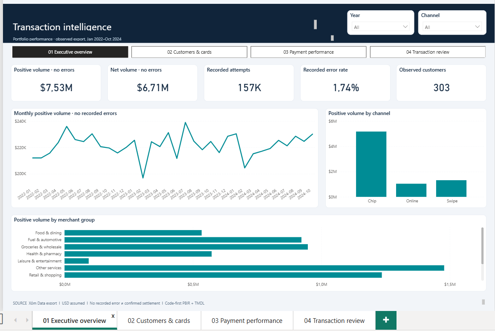
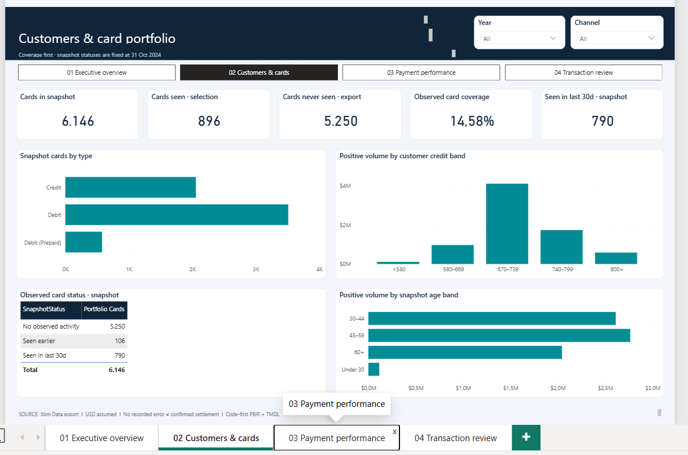
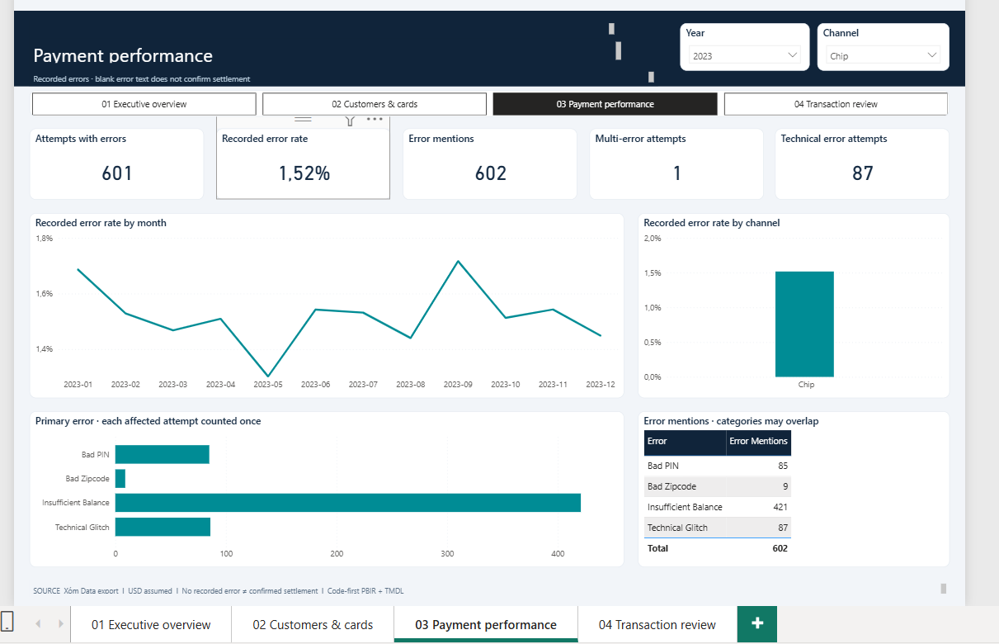
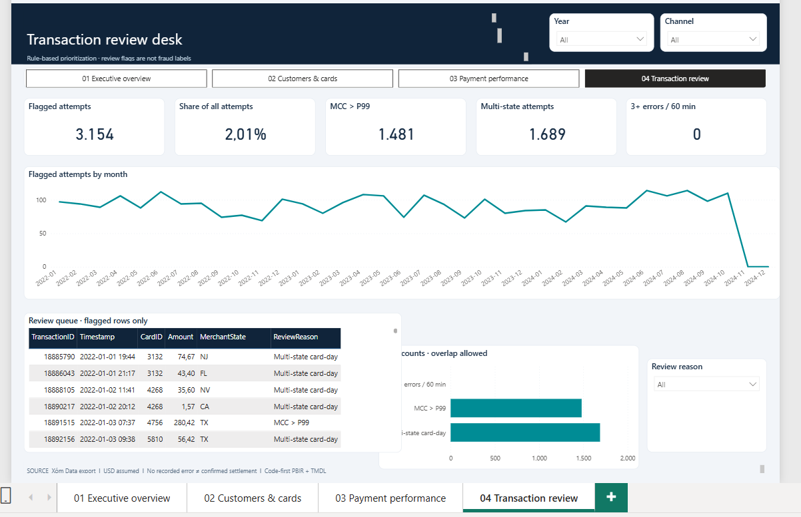
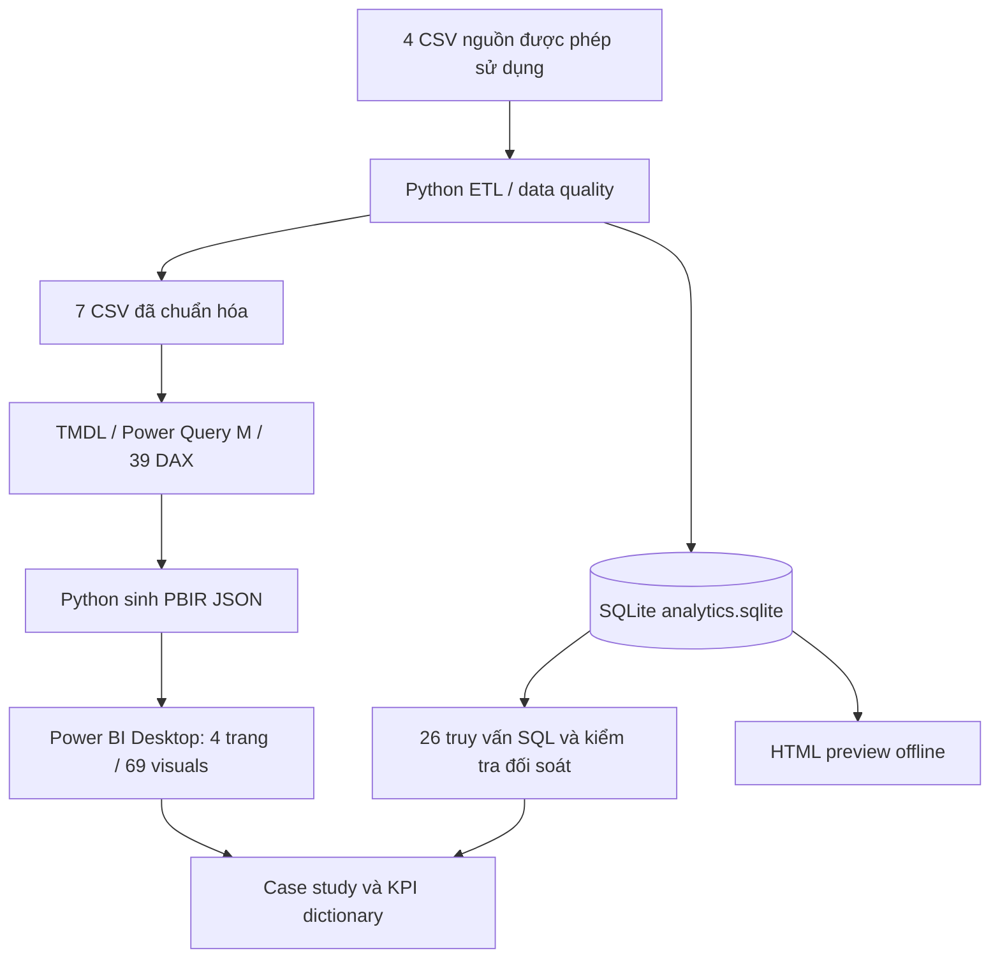

# Banking Customer & Transaction Intelligence

> **Phân tích dữ liệu ngân hàng từ đầu đến cuối | Python ETL · SQL Analytics · Power BI Code-First · DAX · Data Quality**
>

**Banking Customer & Transaction Intelligence** là dự án cá nhân mô phỏng công việc của **Data Analyst / Business Intelligence Analyst** trong lĩnh vực ngân hàng bán lẻ và thẻ thanh toán. Dự án triển khai luồng xử lý từ các bảng dữ liệu gốc, kiểm tra chất lượng dữ liệu, xây dựng mô hình phân tích, viết truy vấn SQL, định nghĩa KPI bằng DAX đến tạo **báo cáo Power BI gốc (native)** hoàn toàn bằng mã Python qua định dạng **PBIP / PBIR / TMDL**.

> **Nguồn dữ liệu:** [Xóm Dataset — Banking / Xóm Bank](https://dataset.xomdata.com/datasets/schema/banking). Đây là dữ liệu thực hành được cung cấp bởi bên thứ ba; dự án **không** phải sản phẩm triển khai tại ngân hàng thật. Phương pháp xây dashboard bằng code lấy cảm hứng từ [emantzoo/powerbi-code-first-dashboards](https://github.com/emantzoo/powerbi-code-first-dashboards); mã sinh mô hình và báo cáo của dự án được tổ chức riêng.

## Mục lục

1. [Tổng quan & mục tiêu nghiệp vụ](#1-tổng-quan--mục-tiêu-nghiệp-vụ)
2. [Dashboard Power BI và ảnh minh chứng](#2-dashboard-power-bi-và-ảnh-minh-chứng)
3. [Dữ liệu & phạm vi](#3-dữ-liệu--phạm-vi)
4. [Kiến trúc hệ thống](#4-kiến-trúc-hệ-thống)
5. [Công nghệ & kỹ năng sử dụng](#5-công-nghệ--kỹ-năng-sử-dụng)
6. [Cấu trúc thư mục](#6-cấu-trúc-thư-mục)
7. [Hướng dẫn cài đặt và chạy từ đầu — từng bước](#7-hướng-dẫn-cài-đặt-và-chạy-từ-đầu--từng-bước)
8. [KPI và kết quả phân tích](#8-kpi-và-kết-quả-phân-tích)
9. [Kiểm thử, đối soát và nghiệm thu](#9-kiểm-thử-đối-soát-và-nghiệm-thu)
10. [Hạn chế & hướng phát triển](#10-hạn-chế--hướng-phát-triển)
11. [Quy tắc bảo mật & công khai trên GitHub](#11-quy-tắc-bảo-mật--công-khai-trên-github)
12. [Nguồn dữ liệu và tài liệu tham khảo](#12-nguồn-dữ-liệu-và-tài-liệu-tham-khảo)

---

## 1. Tổng quan & mục tiêu nghiệp vụ

**Bối cảnh:** Trong tình huống nghiệp vụ Xóm Bank, bộ phận Cards Product, Payment Operations, Retail Banking và Risk Operations cần một nguồn chỉ số nhất quán để theo dõi giao dịch, lỗi thanh toán, độ bao phủ hoạt động của danh mục thẻ và các bản ghi nên được nhân viên rà soát thêm.

**Bốn câu hỏi chính:**

- **Giao dịch:** Có bao nhiêu bản ghi, giá trị giao dịch biến động như thế nào theo thời gian, kênh thanh toán và nhóm thương nhân?
- **Khách hàng & thẻ:** Những khách hàng/thẻ nào xuất hiện trong bản trích xuất giao dịch? Mức độ bao phủ của tập giao dịch so với danh mục thẻ là bao nhiêu?
- **Hiệu suất thanh toán:** Tỷ lệ ghi nhận lỗi theo kênh, nhóm lỗi và thời gian như thế nào? Nhóm nào cần điều tra nguyên nhân?
- **Rà soát giao dịch:** Những quy tắc minh bạch nào có thể tạo một danh sách giao dịch cần kiểm tra thủ công?

**Đầu ra:** pipeline Python tái lập được, cơ sở dữ liệu SQLite, **26 truy vấn SQL**, mô hình 7 bảng phân tích + bảng tổ chức measure, **39 DAX measures**, **4 trang Power BI / 69 visuals**, HTML preview nội bộ và tài liệu phân tích.

## 2. Dashboard Power BI và ảnh minh chứng

### 2.1. Executive Overview — Tổng quan giao dịch

Tổng số bản ghi, Positive/Net Volume, tỷ lệ ghi nhận lỗi, biến động theo tháng, kênh và nhóm thương nhân. Hỗ trợ lọc theo năm/kênh và so sánh xu hướng.



### 2.2. Customers & Cards — Khách hàng và thẻ

So sánh **danh mục thẻ tại snapshot** với **thẻ quan sát được trong tập giao dịch**, phân tích loại thẻ, phân nhóm khách hàng và độ bao phủ dữ liệu.



### 2.3. Payment Performance — Hiệu suất thanh toán

Phân tích số bản ghi có lỗi, tỷ lệ lỗi, số lần lỗi được đề cập và các nhóm lỗi theo kênh/thời gian. Phân biệt **Error Attempts** với **Error Mentions** để không đếm nhầm số giao dịch.



### 2.4. Transaction Review — Danh sách cần rà soát

Theo dõi bản ghi được gắn cờ theo ba quy tắc: giá trị cao theo MCC, nhiều bang trong ngày và chuỗi lỗi trong 60 phút; có bảng chi tiết để kiểm tra.




## 3. Dữ liệu & phạm vi

### 3.1. Bốn bảng nguồn

| Bảng | Số bản ghi trong bản xuất đã phân tích | Vai trò |
|---|---:|---|
| `users` | 2.000 | Thông tin khách hàng và chỉ số tài chính tại snapshot |
| `cards` | 6.146 | Thẻ, chủ thẻ, loại thẻ, thương hiệu và hạn mức |
| `transactions` | 157.224 | Giao dịch, giá trị, thời gian, kênh, thương nhân và ghi chú lỗi |
| `mcc_codes` | 109 | Mã ngành thương nhân và mô tả |

**Thời gian ghi nhận giao dịch:** 01/01/2022 – 31/10/2024. Đây là **quy mô bản CSV mà dự án đã phân tích**, không phải khẳng định tổng số dòng tồn tại trong toàn bộ hệ thống Xóm Data. Phần giới thiệu catalog của nguồn có mô tả về quy mô lịch sử lớn hơn; số lượng có thể phụ thuộc bản xuất và phạm vi truy cập.

### 3.2. Mô hình phân tích

| Bảng sau xử lý | Mức chi tiết (grain) |
|---|---|
| `FactTransaction` | Một dòng / một bản ghi giao dịch (`TransactionID`) |
| `FactError` | Một dòng / một error token gắn với giao dịch |
| `DimCustomer` | Một dòng / một khách hàng |
| `DimCard` | Một dòng / một thẻ |
| `DimMCC` | Một dòng / một mã MCC |
| `DimDate` | Một dòng / một ngày trong khoảng năm của dữ liệu |
| `DimRule` | Một dòng / một quy tắc rà soát; bảng độc lập để hiển thị |
| `KPI_Measures` | Bảng tổ chức các DAX measures, không phải fact dữ liệu |

Thiết kế ưu tiên hướng lọc **DimCustomer → DimCard → FactTransaction**, đồng thời `DimDate` và `DimMCC` lọc fact; `FactError` nối với giao dịch. Chi tiết xem [DATA_MODEL.md](docs/DATA_MODEL.md).

## 4. Kiến trúc hệ thống



- **ETL:** xác thực khóa chính, khóa ngoại và chủ sở hữu thẻ; chuẩn hóa ngày, loại giao dịch, nhóm MCC và lỗi.
- **Tiền tệ:** dùng `Decimal` và số nguyên cent cho các phép đối soát; xuất định dạng hai chữ số thập phân cho BI.
- **Phân tích SQL:** tạo SQLite với view `v_transactions`, `v_monthly`; thực thi 26 câu truy vấn bằng script.
- **Semantic model:** Python tạo các bảng, kiểu dữ liệu, quan hệ, Power Query M, measure DAX, Time Intelligence và định dạng chỉ số.
- **Power BI:** Python sinh trang và visual dưới dạng PBIR JSON; sau đó Power BI Desktop đọc `.pbip` và refresh dữ liệu từ các CSV cục bộ.

## 5. Công nghệ & kỹ năng sử dụng

| Thành phần | Công nghệ / kỹ năng |
|---|---|
| Data processing | Python 3.10+, `csv`, `datetime`, `decimal`, kiểm tra dữ liệu |
| SQL Analytics | SQLite; JOIN, CTE, `ROW_NUMBER`, `LAG`, window aggregation, phân tích thời gian |
| Data Modeling | Fact/Dimension, quan hệ một–nhiều, điều hướng bộ lọc |
| Data Visualization | Power BI Desktop, DAX, Power Query M |
| Code-first BI | PBIP, PBIR JSON, TMDL, Python generator |
| Validation | Kiểm tra tính toàn vẹn, reconciliation tiền ở mức cent, kiểm tra binding và cấu trúc report |
| Version Control | Git/GitHub; chỉ công khai mã nguồn và tài liệu được phép chia sẻ |

Các script chính **chỉ dùng Python standard library**; file `requirements.txt` không liệt kê gói Python ngoài bắt buộc. Power BI Desktop cần cài riêng trên Windows.

## 6. Cấu trúc thư mục

```text
BankingIntelligence/
├── README.md                       # Tài liệu chính (file này)
├── .gitignore                      # Danh mục file không công khai
├── requirements.txt
├── START_HERE.bat                  # Cách chạy tự động, không bắt buộc
├── OPEN_PREVIEW.bat                # Chỉ mở HTML preview đã tạo
├── scripts/
│   ├── pipeline.py                 # ETL + kiểm tra dữ liệu + SQLite
│   ├── run_sql.py                  # Chạy 26 truy vấn SQL
│   ├── build_powerbi.py           # Sinh TMDL / M / DAX / PBIR
│   ├── report.py                  # HTML preview / case study nội bộ
│   ├── validate.py                # Data, SQL, model, report checks
│   ├── validate_schemas.py        # Kiểm tra JSON Schema tùy chọn
│   └── build.py                   # Điều phối toàn bộ luồng
├── sql/
│   ├── analysis.sql               # 26 truy vấn nghiệp vụ Q01–Q26
│   └── schema.sql                 # DDL của SQLite đã tạo
├── powerbi/
│   ├── Banking.pbip                # Project mở bằng Power BI Desktop
│   ├── Banking.Report/            # PBIR: trang và visual JSON
│   └── Banking.SemanticModel/     # TMDL, DAX, Power Query M
├── docs/
│   ├── img/                       # 4 ảnh dashboard thật (bổ sung trước khi public)
│   ├── DATA_MODEL.md
│   ├── KPI_DICTIONARY.md
│   ├── DAX_CATALOG.md
│   ├── CASE_STUDY_VI.md
│   └── ACCEPTANCE_2026-10-23.md
├── assets/                         # HTML template / schema kiểm tra
├── data/
│   ├── raw/                       # CSV nguồn, không commit
│   ├── processed/                 # CSV phân tích, không commit
│   └── analytics.sqlite           # DB nội bộ, không commit
└── reports/                        # Kết quả phân tích, preview, log (không commit)
```

## 7. Hướng dẫn cài đặt và chạy từ đầu — từng bước

Hướng dẫn này **không phụ thuộc việc nhấn `START_HERE.bat`**. Người đọc có thể chạy **từng giai đoạn bằng terminal**, kiểm tra đầu ra và chỉ chuyển bước khi bước trước thành công.

### Bước 1 — Chuẩn bị công cụ

- **Windows 10/11** và **Power BI Desktop** (bản hỗ trợ PBIP / PBIR / TMDL).
- **Python 3.10+**: https://www.python.org/downloads/windows/ (đánh dấu *Add Python to PATH* nếu bộ cài cung cấp lựa chọn).
- **Git**: https://git-scm.com/downloads/win
- **VS Code** (khuyến nghị, không bắt buộc): https://code.visualstudio.com/
- **DBeaver** (tùy chọn để luyện SQL trực tiếp): https://dbeaver.io/download/

Mở **PowerShell** tại thư mục dự án và kiểm tra:

```powershell
py -3 --version
git --version
```

Nếu máy không có lệnh `py`, dùng `python --version` và thay `py -3` bằng `python` ở tất cả các lệnh bên dưới. Dự án không cần cài `pandas` hay `numpy` để chạy pipeline chính.

### Bước 2 — Tải mã nguồn về máy

```powershell
git clone https://github.com/taiiswibu/banking-customer-transaction-intelligence.git
banking-customer-transaction-intelligence.git
cd banking-customer-transaction-intelligence
```


### Bước 3 — Chuẩn bị bốn file CSV từ Xóm Data

1. Truy cập [Xóm Dataset — Banking](https://dataset.xomdata.com/datasets/schema/banking).
2. Đăng nhập, sử dụng quyền truy cập dữ liệu do Xóm Data cung cấp, xem tên bảng/cột bằng SQL Server Management Studio (SSMS) hoặc DBeaver.
3. Xuất những bảng mà bạn **được phép sử dụng**, giữ header gốc, mã hóa **UTF-8**, dấu phân cách dấu phẩy và tên cột đúng theo cấu trúc nguồn.
4. Lưu trong `data/raw/` với **đúng tên file**:

```text
data/raw/users.csv
data/raw/cards.csv
data/raw/transactions.csv
data/raw/mcc_codes.csv
```

**Các cột pipeline cần dùng** (ngoài những cột nguồn khác có thể có):

| File | Cột cần có |
|---|---|
| `users.csv` | `id`, `current_age`, `gender`, `yearly_income`, `total_debt`, `credit_score`, `num_credit_cards` |
| `cards.csv` | `id`, `client_id`, `card_brand`, `card_type`, `has_chip`, `credit_limit`, `acct_open_date`, `expires` |
| `transactions.csv` | `id`, `client_id`, `card_id`, `date`, `amount`, `use_chip`, `merchant_id`, `merchant_city`, `merchant_state`, `mcc`, `errors`, `zip` |
| `mcc_codes.csv` | `mcc_id`, `description` |

**Bảo mật:** Không đưa số thẻ đầy đủ/PAN, CVV, địa chỉ cụ thể, tọa độ cá nhân hoặc thông tin đăng nhập vào GitHub. Nếu bản xuất chứa các trường này, hãy bỏ chúng khỏi bản sử dụng cho portfolio; pipeline không cần các cột này. Không công khai bất kỳ bản dữ liệu có nguồn gốc Xóm Data nào khi chưa có quyền phù hợp.

**Kiểm tra đầu vào:**

```powershell
Get-ChildItem data\raw\*.csv | Select-Object Name, Length
Get-Content data\raw\transactions.csv -TotalCount 1
```

Nếu gặp lỗi `FileNotFoundError`, kiểm tra tên và vị trí CSV. Nếu gặp `KeyError`, kiểm tra header có đúng tên theo bảng trên hay không; không tự đổi ý nghĩa cột để ép chạy.

### Bước 4 — Chạy ETL, tạo dữ liệu phân tích và SQLite

Tại **thư mục gốc** chứa `scripts/`, chạy:

```powershell
py -3 scripts/pipeline.py
```

Script thực hiện kiểm tra khóa chính/khóa ngoại, quan hệ chủ thẻ, chuyển đổi tiền về cent, xác định cờ rà soát và xuất **7 CSV phân tích** vào `data/processed/`. Đồng thời tạo `data/analytics.sqlite` và một số chỉ số kiểm tra trong `reports/`.

Kiểm tra kết quả:

```powershell
Get-ChildItem data\processed\*.csv | Select-Object Name, Length
Test-Path data\analytics.sqlite
Get-Content reports\metrics.json -TotalCount 25
```

**Lưu ý:** Việc xây dựng lại sẽ ghi lại file SQLite. Sao lưu các kết quả riêng nếu bạn muốn giữ trước khi chạy lại.

### Bước 5 — Chạy 26 truy vấn SQL

```powershell
py -3 scripts/run_sql.py
```

Kết quả được xuất vào `reports/sql_results/Q01.csv` đến `Q26.csv` và `reports/sql_validation.json`.

Có thể mở `data/analytics.sqlite` trong DBeaver bằng kết nối **SQLite**, rồi đọc và chạy từng câu trong `sql/analysis.sql` để kiểm chứng JOIN/CTE/window functions. Không kết nối file `.sqlite` bằng driver SQL Server.

### Bước 6 — Sinh mô hình và giao diện Power BI bằng code

**Đóng Power BI Desktop** trước khi sửa hoặc sinh lại PBIR/TMDL, nhằm tránh xung đột với file đang mở.

```powershell
py -3 scripts/build_powerbi.py
```

Script tạo/cập nhật `powerbi/Banking.pbip`, TMDL và các thành phần semantic model, 39 DAX measures và 4 trang/69 visual dưới dạng PBIR JSON. Đường dẫn dữ liệu máy cá nhân được ghi vào `expressions.tmdl` **chỉ để sử dụng cục bộ**, file này được `.gitignore` loại trừ.

> Nếu muốn chỉnh sửa **lâu dài** bố cục trang, tên biểu đồ, DAX, relationships hay đường dẫn nguồn, hãy thay đổi code generator trong `scripts/build_powerbi.py`, sau đó sinh lại. Chỉnh trực tiếp các JSON/TMDL được sinh ra có thể bị ghi đè ở lần build sau.

### Bước 7 — Mở và refresh trong Power BI Desktop

1. Mở `powerbi/Banking.pbip` bằng Power BI Desktop.
2. Nếu phiên bản Desktop yêu cầu, bật **PBIP / Enhanced report format (PBIR) / TMDL** trong `File → Options and settings → Options → Preview features` rồi mở lại dự án.
3. Chọn **Home → Refresh**, hoặc **Apply changes** nếu có thông báo.
4. Nếu báo không tìm thấy CSV: kiểm tra bốn file nguồn, thực hiện lại Bước 4 và Bước 6 trên **máy hiện tại**, rồi mở lại `.pbip`. Không commit đường dẫn tuyệt đối từ máy của bạn lên GitHub.
5. Kiểm tra bốn trang: Executive Overview, Customers & Cards, Payment Performance, Transaction Review.
6. Đưa Year/Channel về **All** trước khi đối soát KPI tổng.

**Power BI chỉ tải và thực thi báo cáo khi mở bằng Desktop.** Chạy Python sinh PBIR thành công không thay thế việc refresh, đánh giá DAX và nghiệm thu trên Desktop.


### Bước 8 — Chạy kiểm tra độc lập

Sau khi hoàn thành SQL, Power BI và HTML preview, chạy:

```powershell
py -3 scripts/validate.py
```

Kiểm tra cấu trúc Power BI, trường dữ liệu, quan hệ, đối soát giao dịch/tiền và số lượng truy vấn. Kết quả viết ra `reports/validation.json`.

Nếu muốn kiểm tra thêm JSON schema của PBIR (tùy chọn, cần gói ngoài):

```powershell
py -3 -m pip install jsonschema
py -3 scripts/validate_schemas.py
```

**Phạm vi kiểm thử:** `validate.py` không chạy thay engine của Power BI. Bạn vẫn cần kiểm tra hình ảnh thực tế và DAX sau Refresh.

### Bước 9 — Đối chiếu Power BI và lưu bản `.pbix`

Khi **không có bộ lọc**, các giá trị kỳ vọng đối với bản dữ liệu đã được phân tích được liệt kê tại [mục KPI](#8-kpi-và-kết-quả-phân-tích). Thử `Year = 2023`: Attempts = **55.507**; bỏ bộ lọc năm rồi thử `Channel = Online`: Attempts = **17.783**, Error Attempts = **445**. Xác nhận hai phép đối soát DAX bằng **0**.

Cuối cùng chọn `File → Save As → Power BI report (*.pbix)` và lưu bản riêng trên máy. **Không commit file `.pbix` chứa dữ liệu import** lên repository public khi chưa có quyền phân phối.

## 8. KPI và kết quả phân tích

Các số dưới đây được tính trên **bản trích xuất đã phân tích** với bộ lọc tổng, không mặc định áp dụng cho toàn bộ dữ liệu lịch sử của nguồn:

| Chỉ tiêu | Kết quả | Diễn giải |
|---|---:|---|
| Recorded Attempts | **157.224** | Bản ghi trong `FactTransaction` |
| Error Attempts | **2.738** | Bản ghi có ít nhất một error token |
| Error Rate | **1,74%** | Error Attempts / Recorded Attempts |
| Error Mentions | **2.756** | Tổng số lần lỗi được ghi nhận; có giao dịch chứa nhiều loại lỗi |
| Positive Volume | **$7.533.887,55** | Tổng giá trị dương trên dòng không ghi nhận lỗi |
| Net Volume | **$6.706.704,55** | Tổng giá trị ròng trên dòng không ghi nhận lỗi |
| Observed Customers | **303** | Khách hàng có giao dịch trong bản xuất |
| Observed Cards | **896** | Thẻ xuất hiện trong bản giao dịch |
| Portfolio Cards | **6.146** | Thẻ trong bảng danh mục snapshot |
| Observed Card Coverage | **14,58%** | 896 / 6.146 |
| Review Attempts | **3.154** | Số dòng nằm trong hợp ba quy tắc rà soát |

**Các phát hiện đáng chú ý:**

- **Online Error Rate: 2,50%** so với **Chip: 1,62%** (so sánh mô tả, **không suy ra quan hệ nhân quả**). Đề xuất điều tra thêm theo merchant, MCC và log gateway.
- Chỉ **896/6.146 thẻ** xuất hiện trong trích xuất giao dịch; **5.250 thẻ còn lại không thể tự động coi là dormant**, vì chưa xác nhận lịch sử đầy đủ.
- Ba quy tắc rà soát gắn cờ: **1.481 High Value**, **1.689 Multi State**, **0 Error Burst**; hợp của chúng có **3.154 giao dịch**, vì có chồng lặp. **Không có nhãn xác nhận gian lận**.

**Giới hạn thuật ngữ tài chính:** `Positive Volume` và `Net Volume` **không phải doanh thu/lợi nhuận ngân hàng**; trường `errors` để trống chỉ cho biết không ghi nhận lỗi trong bản xuất, **không chứng minh đã settlement thành công**. Dấu `$` là giả định tiền USD theo bối cảnh Mỹ vì nguồn không có cột currency.


## 9. Hạn chế & hướng phát triển

- Bản xuất chỉ đại diện dữ liệu được cung cấp; cần xác minh độ bao phủ trước khi suy rộng cho toàn ngân hàng.
- Chưa có trạng thái settlement, hồ sơ đầy đủ thay đổi theo thời gian hoặc nhãn gian lận.
- Quy tắc P99 được ước lượng hồi cứu trên toàn bộ bản xuất; không được coi là mô hình gian lận đã kiểm định production.
- Credit/volume proxy không chứng minh rủi ro tín dụng hoặc khả năng vỡ nợ.
- Có thể phát triển thêm bộ dữ liệu thời gian, log thanh toán, nhãn rà soát thật, precision/false-positive analysis, incremental refresh và automated CI tests.
- Dashboard hướng tới hỗ trợ quyết định của người phân tích, **không thực hiện khóa thẻ hay xử lý thanh toán tự động**.


## 10. Nguồn dữ liệu và tài liệu tham khảo

1. **Nguồn dữ liệu và đề bài:** [Xóm Dataset — Banking](https://dataset.xomdata.com/datasets/schema/banking) — mô tả bối cảnh Xóm Bank, 4 bảng và các câu hỏi phân tích.
2. **Quyền sử dụng nội dung:** [Xóm Data — Terms of Service](https://xomdata.com/terms).
3. **Tham khảo cách xây dashboard bằng code:** [emantzoo/powerbi-code-first-dashboards](https://github.com/emantzoo/powerbi-code-first-dashboards) — phương pháp Python tạo visual PBIR và cấu trúc dự án. Đây là nguồn cảm hứng kỹ thuật; các chỉ số/dữ liệu không lấy từ repository tham khảo.
4. **Tài liệu Microsoft:** [Power BI Desktop Projects (PBIP)](https://learn.microsoft.com/en-us/power-bi/developer/projects/projects-overview), [PBIR enhanced report format](https://learn.microsoft.com/en-us/power-bi/developer/embedded/projects-enhanced-report-format) và [TMDL view](https://learn.microsoft.com/en-us/power-bi/transform-model/desktop-tmdl-view).

---

**Mục tiêu portfolio:** Thể hiện năng lực thực hiện quy trình Data Analyst hoàn chỉnh từ chuẩn hóa dữ liệu và SQL đến mô hình KPI, Power BI và diễn giải kết quả có kiểm soát giới hạn dữ liệu. Mọi khuyến nghị được trình bày là **đề xuất phân tích**, không phải kết quả cải thiện kinh doanh đã được triển khai và đo lường.
