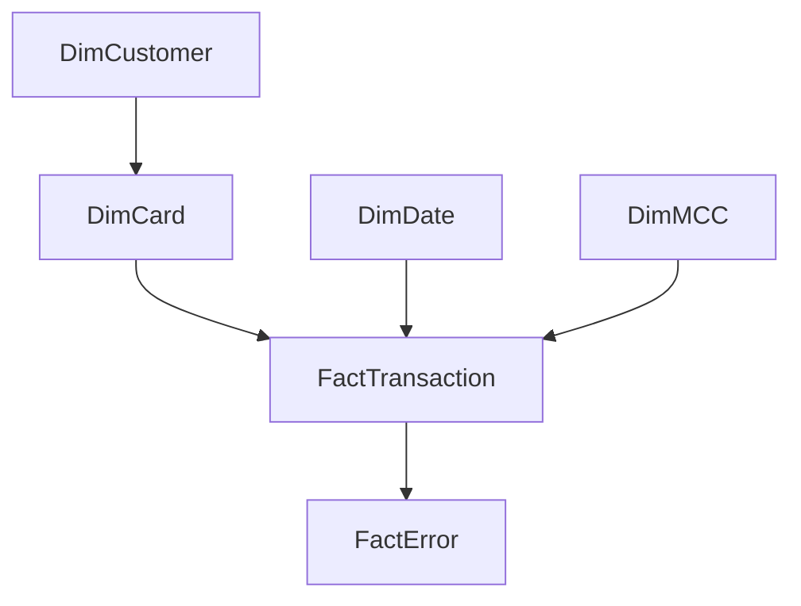

# Data model and lineage

## Filter topology

Arrows show one-direction filter propagation from the unique side to the many side. DimRule is disconnected and is interpreted by the `Rule Attempts` measure. Measures is a disconnected one-row table containing DAX measures. ClientID in FactTransaction is retained for distinct observed counts and validation; there is no second direct customer relationship. FactError filters do not propagate back into FactTransaction.

## Table grains and principal fields

| Table | Key / grain | Fields and meaning |
|---|---|---|
| DimCustomer | ClientID, unique customer | SnapshotAge, AgeBand, Gender, YearlyIncome, TotalDebt, CreditScore, CreditBand, ReportedCreditCards |
| DimCard | CardID, unique card | ClientID owner; Brand; CardType; HasChip; CreditLimit snapshot; OpenedDate; Expires; ObservedTransactions; ObservedActive; LastObservedDate; DaysSinceObserved; SnapshotStatus; LongOpenUnobserved |
| DimDate | Date, one day | Full calendar years covering source fact; Year, MonthNumber, Month, YearMonth, MonthStart, Weekday |
| DimMCC | MCC, unique merchant code | Description; project MerchantGroup rollup; P99Amount and ReferenceCount frozen to full-export eligible distribution |
| FactTransaction | TransactionID, unique source row | Timestamp; Date; ClientID; CardID; AmountCents; Amount; Channel; MerchantID; MerchantCity; MerchantState; MCC; Errors; HasError; ErrorCount; PrimaryError; AmountType; IsPhysicalUS; three rule flags; ReviewFlag; ReviewStatus; ReviewReason |
| FactError | TransactionID × error token | One row per comma-separated error token; Error |
| DimRule | Rule | Three descriptive rule labels |
| Measures | One hidden Anchor row | DAX-only organizational table |

Dates are imported as dateTime in TMDL with calendar-day values at midnight where appropriate. DimDate[Date] is the key of the Time-category date table. Month sorts by MonthNumber; YearMonth is ISO text and sorts lexically. No auto date/time hierarchy is required. YearMonth currently spans Jan 2022–Dec 2024; fact ends Oct 2024.

## Transformations and exclusions

1. Validate unique primary keys and all join keys before enrichment.
2. Parse amounts with Decimal and preserve exact integer cents. Derived Amount is the two-decimal import representation.
3. Retain negative/zero amounts, error rows, online locations and missing postal fields. Do not drop rows to improve KPI results.
4. Normalize channel labels by removing ` Transaction`; split error text into tokens. Missing Errors is No error only for the recorded-error proxy.
5. Fit descriptive MCC thresholds, compute chronological review rules and card snapshot summaries.
6. Export dimensional CSVs and SQLite data with indexes on transaction key, card, client, date and MCC.
7. Build native import partitions referencing the absolute DataFolder parameter, not credentials or external services.

Source PAN, CVV, address and coordinates were omitted from the private raw copies in this package. Those columns are not used for the analysis. `zip` remains in the reduced raw transaction file for profiling but is not imported to the analytical model. `ReportedCreditCards` is an unverified source snapshot attribute, not used as the portfolio denominator; COUNTROWS(DimCard) is used instead.

## SQLite objects

- Seven analytical tables mirror exported CSVs (plus MonthlySummary as an auxiliary CSV only).
- `v_transactions` joins fact to card/customer/MCC without changing grain.
- `v_monthly` aggregates counts and exact cents by year-month.
- `sql/schema.sql` records executable table/index/view DDL generated from this database; the data are loaded by the pipeline.

## Reproducibility

Source hashes of the reduced raw CSVs are stored in `reports/data_quality.json`. Thresholds use linear interpolation at index `(n−1)×0.99` on sorted eligible integer cents. Transactions are ordered by Timestamp, TransactionID. The review reason label order is high-value, multi-state, then error-burst, making files deterministic for a fixed source and output path.

Changing the `DataFolder` path changes TMDL content only; it does not change metrics. Refreshing in Desktop is still required because no proprietary model cache is shipped. Native execution of M/DAX and rendering remains a separate Windows acceptance step.
